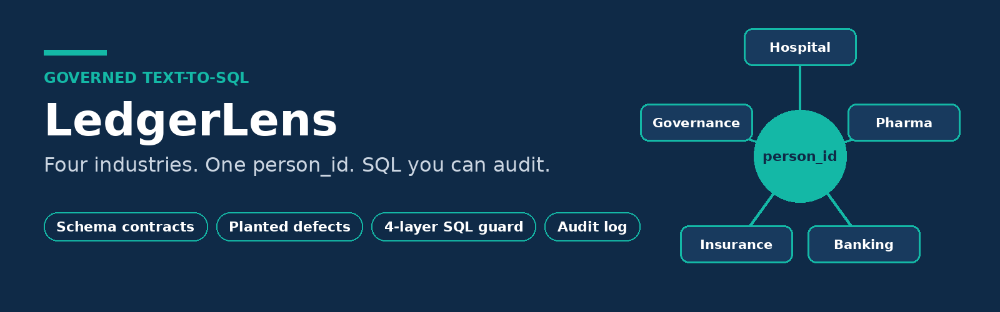
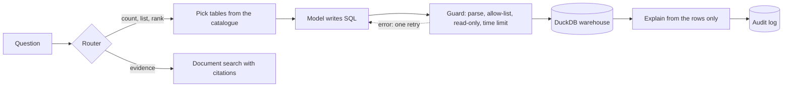
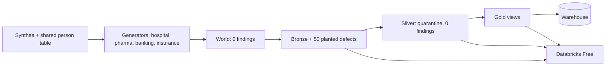

  

# LedgerLens

**Governed text-to-SQL across four industries.** Ask a question in English and get a
number you can check, trust and audit.

> ⚠️ **Synthetic data only.** Patients come from [Synthea](https://github.com/synthetichealth/synthea);
> banking and insurance data is generated. No client data or client code.

## Why

Document search answers "show me the evidence", but it only sees the records it retrieves, so
it cannot count. Text-to-SQL can count every row, but only if the model's SQL is safe, the data
is trustworthy, and the answers are measured.

## What it does

| Area | Result |
|---|---|
| One synthetic world | 1,173 people with hospital, pharma, banking and insurance records, linked by `person_id`. 330K+ rows |
| Data rules | Fixed seeds; no activity after death; claims after visits; payouts only for approved claims. 0 violations |
| Schema contracts | One `schema.yaml` per domain drives generation, checks, the warehouse and the prompt |
| Data quality | 50 defects planted with a register. 50/50 found in Bronze, 0 unexpected, 0 left in Silver |
| Lakehouse | Bronze, Silver, Gold in Parquet and DuckDB, loaded to Databricks Free and reconciled by row count |
| SQL guard | Parse check, table allow-list, read-only connection with file access off, time limit. 26/26 hostile tests blocked |
| Audit | Every question, chosen tables, SQL, tables read, errors, rows and time logged |
| Measurement | 107 validated test questions scored by result, 3 runs each; router 112/112 (SQL, documents, or both) |

## Execution accuracy

Share of questions whose generated SQL returns the same result as a validated gold query.
Mean of 3 runs; spread is the standard deviation between runs.

| Domain | Accuracy | Spread | Questions |
|---|---|---|---|
| Insurance | 1.00 | 0.00 | 20 |
| Hospital | 0.98 | 0.02 | 20 |
| Banking | 0.98 | 0.02 | 20 |
| Data governance | 0.90 | 0.00 | 20 |
| Pharma | 0.88 | 0.02 | 20 |
| Cross-industry | 0.76 | 0.07 | 7 |

Each domain set has 18 SQL questions and 2 the data cannot answer (the model must refuse).
Cross-industry questions join several domains on `person_id` and are the main area to improve.

## How a question flows

## Data flow

## Lessons

1. Safety lives in the database connection, not in the prompt.
2. Test a data-quality check with an answer key.
3. A refusal can be a bug: check what the model was shown.
4. Split hybrid questions: numbers to SQL, text to documents.
5. An ambiguous question can produce a precise wrong number. Always show the SQL.

## Where the code is

| Path | Purpose |
|---|---|
| `core/sql/` | Catalogue, checks, lake build, guard, generator, scoring, runner, router |
| `domain_packs/<domain>/schema.yaml` | Schema contracts |
| `scripts/gen_*.py`, `scripts/plant_defects.py` | Data generation and defect planting |
| `tests/sql/` | Guard suite, test questions, router list |
| `notebooks/databricks/` | Lakehouse load and reconciliation |

## Author

**Sabyasachi Sahu**: personal learning and portfolio project.
