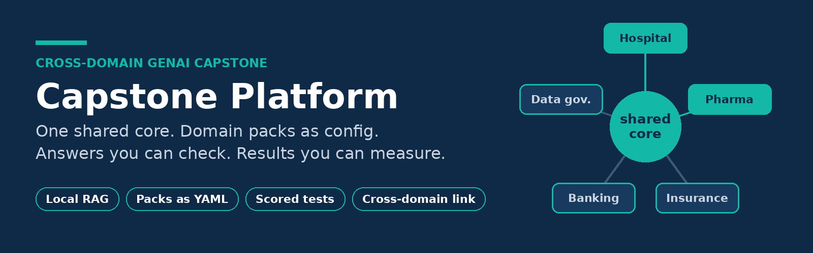
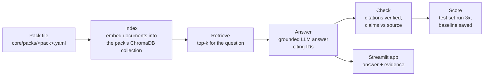

<p align="center">
  
</p>

<p align="center">
  
  
  
  
  
  
  
</p>


> 🔎 **New: [LedgerLens](LEDGERLENS.md)**, governed text-to-SQL across four industries: one shared person ID, planted defects that are all caught, a four-layer SQL guard, and 0.95 execution accuracy.

# Capstone Platform

**A cross-domain GenAI platform built in phases on free and local tools.** One shared core serves several domain *packs*, such as hospital records, drug labels and, later, insurance, banking and data governance. All of them share one synthetic population, linked by a common `person_id`.

The goal isn't a demo that looks right. It's a system whose answers can be **checked** and whose quality can be **measured**, so every later stage has a baseline to beat.

> ⚠️ **Synthetic data only.** Patients are generated with [Synthea](https://github.com/synthetichealth/synthea). Drug labels come from the public [openFDA](https://open.fda.gov/) API, which is unvalidated and **not for medical decisions**. This repository contains no client data or client code.

---

## Why this project

My first RAG pipeline answered questions about patient records well. Then it cited a real patient and gave them a condition they didn't have. **The citation check passed**, and only a claim-level check against the source record caught the error.

That shaped the rest of the build:

- **Verify claims, not just citations.** A cited ID existing doesn't make the fact attached to it true.
- **Measure before improving.** LLM output changes between runs, so one good run proves very little.
- **Reuse, don't copy.** A new domain should be configuration, not a fork of the code.

---

## Architecture



Search, answering, citation checking, indexing and scoring all read the **pack file**. Adding a domain means adding a pack file and a document builder. The core code doesn't change.

```yaml
# core/packs/pharma.yaml (abridged)
name: pharma
collection: pharma
top_k: 6
system_prompt: |
  Answer ONLY from the label excerpts...
test_file: tests/pharma_p3.yaml
```

---

## What's built so far

| Phase | What it delivers | Status |
|---|---|---|
| 0 | Environment, Git and the shared synthetic world (Synthea, one `person_id` across roles) | ✅ Done |
| 1 | VS Code workflow: debugging, notebooks on the project venv, Ruff linting and formatting | ✅ Done |
| 2 | Local RAG on patient records: documents, ChromaDB index, retrieval, grounded answers, citation check, claim check | ✅ Done |
| 3 | Pack configuration, scored test sets and baselines, openFDA drug-label pack, drug dictionary, Streamlit app | ✅ Done |
| 4 | **LedgerLens**: hospital, pharma, banking and insurance data on one person ID; 50 planted defects all caught; Bronze/Silver/Gold in DuckDB and Databricks; guarded, audited text-to-SQL; 107 tests | ✅ Done |
| Next | Investigation agents over the same tables | 🔜 Planned |

### Phase 3 highlights

- 🧩 **Packs as configuration.** A third demo pack dropped into `core/packs` appeared in the app with no code changes.
- 🧪 **Two 10-question test sets scored by code.** Five question types (`find`, `comorbidity`, `refuse_count`, `unanswerable`, `label_fact`) with rule-based gold answers that survive the model rewording its answers.
- ✅ **Tests validated against the data first.** Each gold condition or label term is checked to exist before any score is trusted.
- 📏 **Baselines from repeated runs.** Every question runs 3 times. The mean is the baseline, and the spread is the noise floor.
- 💊 **openFDA drug-label pack.** Single-ingredient labels for 10 common chronic-care drugs, chunked by section (1,200 characters, 150 overlap) so every citation names the drug and section, e.g. `metformin.boxed_warning.01`.
- 🔗 **First cross-domain link.** A drug dictionary maps label drugs to Synthea medications, so you can ask which patients take a drug and what conditions they have.
- 🖥️ **Streamlit app that shows its own checks.** Verified and unverified citations, the claim check for patient answers, and the retrieved sources with similarity scores.

---

## The domain roadmap

| Pack | Domain | Example question |
|---|---|---|
| **CareBridge** | Hospital | What conditions commonly occur alongside type 2 diabetes? |
| **PharmaSignal** | Pharma | What does the boxed warning for this drug say? |
| **ClaimSense** | Insurance | Planned |
| **CreditGuard** | Banking | Planned |
| **DataSteward** | Data governance across all packs | Planned |

The flagship cross-domain chain, to be built in later phases, runs adverse event → readmission → claim → payout → fraud ring, all on the same synthetic people.

---

## Quick start (Windows, PowerShell)

> Prerequisites: Python 3.11, Git, [Ollama](https://ollama.com/), and a Synthea output folder. Model names and `SYNTHEA_DIR` go in a local `.env` file, which is git-ignored.

```powershell
git clone https://github.com/Sabyasachi-Sahu/capstone-platform.git
cd capstone-platform
py -3.11 -m venv .venv
.\.venv\Scripts\Activate.ps1
pip install -r requirements.txt

ollama pull nomic-embed-text

# list the packs and whether each one is indexed
python -m src.phase3.packs

# ask a question against a pack
python -m src.phase3.pack_rag hospital "What conditions commonly occur alongside type 2 diabetes?"

# open the app
streamlit run app/streamlit_app.py
```

Generated data (`data/processed/`, `data/vectordb/`) is **not** committed. The build scripts recreate it.

---

## Repository layout

```text
capstone-platform/
├── app/                # Streamlit app
├── core/packs/         # one YAML file per domain pack
├── src/
│   ├── common/         # shared settings and paths
│   ├── phase2/         # patient RAG, citation and claim checks
│   └── phase3/         # packs, pack RAG, indexing, test runner
├── tests/              # question sets with rule-based gold answers
├── requirements.txt
└── README.md
```

---

## Engineering practices

- **Diagnose before fixing.** Each defect is reproduced and explained before the code changes.
- **Specific error handling.** Catch-all `except Exception` blocks were replaced with the expected error, such as ChromaDB's `NotFoundError`, so real failures can't hide. The two remaining deliberate catch-alls (the test runner and the UI) are documented inline.
- **Commit code, config, tests and baselines.** Never data, indexes, secrets or raw model outputs.
- **Ruff-clean** linting and formatting on every commit.

---

## Known limitations

- RAG sees only the top-k retrieved records, so it **can't count or list everything**. That is the job of text-to-SQL in the next phase.
- The claim check verifies that a named condition is in the cited record. It **doesn't verify scope wording** such as "all patients" or "most common".
- Scores come from a small test set with a cloud-hosted chat model, so treat them as a baseline for comparison, not as a benchmark.

---

## Author

**Sabyasachi Sahu** · Senior Data Scientist

Built as a personal learning and portfolio project. Feedback and questions are welcome through GitHub issues.
